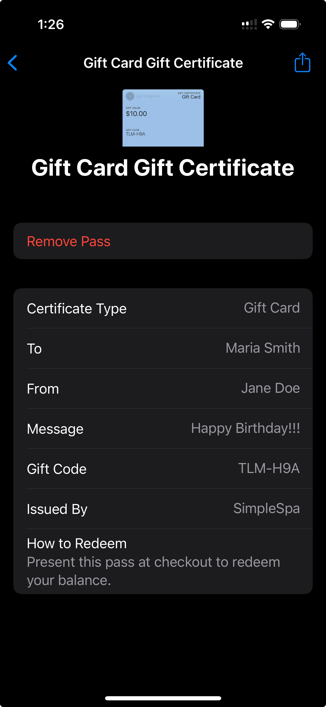
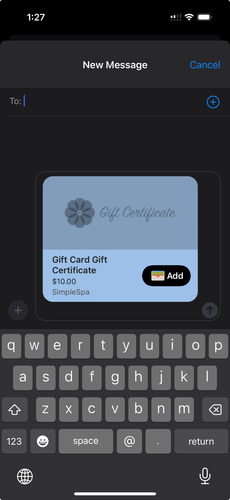

# Apple Wallet

## SimpleSpa Gift Certificates can now be saved directly to Apple Wallet

* All gift certificates now include a “Add to Apple Wallet” button in the Emails sent to the recipient

<figure><figcaption>
A sample client recipient email, this includes a convenient Add to Wallet button
</figcaption></figure>

* The pass shows:
  * Gift value
  * Unique redemption code
  * QR code for fast scanning
  * Business branding (theme color)

<figure><figcaption>
Adding a Gift Certificate to Apple Wallet
</figcaption></figure>

<figure><figcaption>
Viewing Gift Certificate Pass Details
</figcaption></figure>

Users will also have the ability to use the Add to Apple Wallet at the end of their checkout process once the certificate has been issued, data populated will dynamically be added before adding to their wallet

<figure><figcaption>
The end user UI for sending a Gift Certificate, includes a working Add to Wallet button
</figcaption></figure>

End users can easily share their added certificate using the share option in iOS

<figure><figcaption>
Sharing a Gift Certificate using iMessage with automatic rendering
</figcaption></figure>

### Why This Is Awesome

* Convenient access: Customers don’t need to dig through email
* Works offline: No Wi-Fi needed at redemption time
* Beautiful and professional: Branded with your business’s look
* Scan-to-redeem: Works with QR scanning at POS

## The Gift Certificate Flow

1. 🎁 A client purchases or receives a gift certificate
2. 📧 They receive a confirmation email with:
   * The gift code
   * A link to a branded preview page
   * A “Add to Apple Wallet” button
3. 🍏 They tap the button, preview the pass, and add it to Wallet
4. 🏪 When they visit your spa, they:
   * Open their Wallet
   * Show the pass QR code at checkout
5. 🎯 You scan the QR using your POS or camera, and it auto-fills the code

## QR Code Scanning at Checkout

You can now scan a gift certificate QR using:

* 📷 A camera on your POS computer/tablet
* 🔘 The built-in “Scan with Camera” button
* 🎯 Your terminal scanner (if enabled)

This automatically detects the gift code and enters it in the gift certificate field — no typing required.

> ⚡ Tip: The scanner supports both QR codes and barcodes, so if you add physical GCs in the future, they’ll work too!

## 📌 Summary

Apple Wallet and QR support dramatically improve the redemption experience:

* Less friction for clients
* Faster checkouts
* Modern, branded feel
