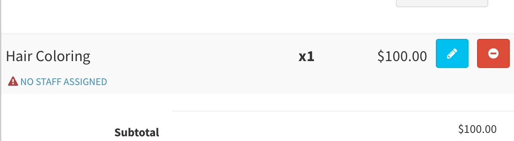

# Assigning Staff during Checkout

Staff will automatically be assigned if you are checking out directly from an appointment. The POS will allocate the staff that is servicing the appointment automatically. Assigned staff will be applied a commission if they have commissions enabled for the service category or universal commissions & tips will be allocated accordingly based on what has been tipped

To adjust the staff per service, click on the section that either has “NO STAFF ASSIGNED” or the staff name&#x20;

<figure><figcaption></figcaption></figure>

This will bring up a prompt to select the staff to apply for the respective service

<figure><figcaption></figcaption></figure>

<figure><figcaption></figcaption></figure>
