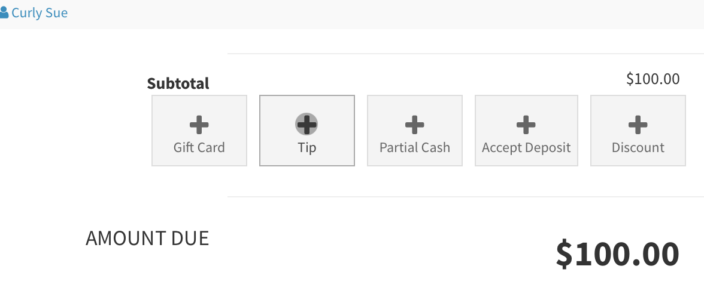

# Prompting and Collecting Tips

## Tip Menu

To access the tip menu in the POS, press the +Tip button, this will open up the tip section in the POS. Here you can select the percentage of tip to be applied, under there is a tip adjust (half moon button), if the terminals support tip prompting there will be dedicated terminal buttons to send the tip prompt to the terminal, and then there is a tip prompt button (windows button), which will show an in app tip prompt. Tips as calculated and assigned per tippable items (services), but manually you can set any tip amount by entering it directly in the tip input area

<figure><figcaption></figcaption></figure>

<figure><figcaption></figcaption></figure>

## Tip Prompt

In the POS there is an option to show an on screen tip prompt which will show the cart total along with the items being sold, with large buttons selecting the tippable amount to be applied. To access this prompt press the window buttons in the Tip section

<figure><figcaption></figcaption></figure>

## Tip Adjust

If you need to collect a tip for a staff/provider without selling a service or product, SimpleSpa has a tip adjust line item that can be added to your cart. This is a 0 value item that you can assign a staff, and under set the tip amount, to add this item press the "Half Moon" icon, and then set the tip amount directly, i.e. in the cart under the tip adjust has been added and the tip amount is set to 25.00

<figure><figcaption></figcaption></figure>
