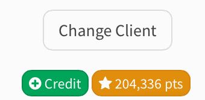

# Redeeming Loyalty Points During Checkout

This page shows you how to use a client's loyalty points to take money off a sale in the POS.

Before you start, turn on redemption in **Marketing → Loyalty**. See [Loyalty Points](../../../reports-and-marketing/marketing/loyalty-points.md#turn-on-point-redemption).

## Redeeming points



### Add the client and the items

Select the client in the POS and add everything they are buying. Points can be used on services, products, packages and gift certificates.



### Press the points button

Next to the client's balance and credit, a yellow **★ points** button shows how many points the client has. Press it to open **Redeem points**.




### Choose how many points to use

Use **+** and **−** to change the amount. Points are used in whole blocks, for example 500 points at a time. Press **Use maximum** to use as many as the client has, up to the value of the cart. The window shows how much comes off the sale.



### Apply

Press **Apply**. A **Points Redemption** line is added to the cart with the number of points used.




### Take payment as usual

Collect the rest with any payment type except client balance. When you complete the sale, the points are taken off the client's balance.



## How the redemption is applied

* **It works like a discount.** The amount comes off before tax, so the tax on the sale goes down too.
* **No points are earned on the part paid with points.** The client still earns points on the rest of the sale.
* **Staff commission is not affected.** Commission is still based on the full service price.
* **The points are checked again before payment.** If the client no longer has enough points, for example because they were used at another station, SimpleSpa stops before any card is charged so you can adjust the redemption.

## Changing or removing a redemption

* To change the number of points, press the pencil button on the **Points Redemption** line.
* To remove it, press the minus button on the line, or press **Remove** in the **Redeem points** window.
* If you remove items from the cart, the redemption is reduced so it is never more than the cart is worth.

## When points can't be redeemed

The points button and redemption are not available when:

* No client is selected, or the client is a walk-in.
* The client has fewer points than one block.
* The sale is a deposit, or you are saving it as an open invoice.
* You are settling an existing receipt or open invoice.
* You are paying with the client's balance, or splitting the payment with **Multiple Payments**.
* The cart contains a membership.

Only one points redemption can be added to each sale.


If a full refund is made later, the redeemed points go back to the client. See [Loyalty Points](../../../reports-and-marketing/marketing/loyalty-points.md#refunds-and-points).


## Related

* [Loyalty Points](../../../reports-and-marketing/marketing/loyalty-points.md)
* [Applying Discounts During Checkout](applying-discounts-during-checkout.md)
* [Balances & Deposits](../balances-and-deposits.md)
