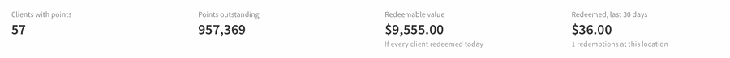

# Loyalty Points

Loyalty points reward clients each time they spend money with you. Clients earn points on their purchases and can redeem them for money off a sale in the POS. Set up both on the **Loyalty** tab in **Marketing**.

## Set your earning rule



### Open the Loyalty tab

Go to **Marketing → Loyalty**.



### Set the points rate

Complete the sentence **Earn \[X] points for every \[$Y] spent**.



### Reward online bookings (optional)

Set **Plus \[N]% bonus points on online bookings** to encourage clients to book online.



### Choose what earns points

Turn on the categories that earn points: **Services**, **Products**, **Packages** and **Gift Certificates**.



The live preview shows the result, for example _A $100 sale earns 100 points. Booked online: 110 points_.

## Turn on point redemption



### Set the redemption rate

In the **Point Redemption** section, complete the sentence **Every \[X] points are worth \[$Y] off a sale**. For example, every 500 points are worth $10.00.



### Check the preview

The preview shows how much clients get back and how much they need to spend for their first reward, for example _Clients get about 2% back, and their first reward comes after $500.00 of spend_. Use it to check that your earning and redemption rates work well together.



### Save

Press **Save**. The label next to **Point Redemption** changes to **On**.



Clients can now redeem points at checkout. To learn how, see [Redeeming Loyalty Points During Checkout](../../daily-operations/pos/common-checkouts-and-tutorial-walkthroughs/redeeming-loyalty-points-during-checkout.md).


**How a redemption is applied.** A redemption works like a discount, so it lowers the taxable amount. Clients don't earn points on the part of a sale they pay with points, and staff commission is still based on the full service price.


### Turning redemption off

Set either value to **0** and press **Save**. The label changes to **Off** and the points button no longer appears in the POS. Clients keep their points and keep earning new ones, so you can turn redemption back on at any time.

## Program totals

At the top of the Loyalty tab you can see:

* **Clients with points** – how many clients have a points balance.
* **Points outstanding** – the total points your clients hold.
* **Redeemable value** – what those points would be worth if every client redeemed today.
* **Redeemed, last 30 days** – the value of points redeemed at this location in the last 30 days.

Redeemable value and redeemed value only appear when redemption is on.

For points earned and redeemed over any date range, with a list of every redemption and your top clients, see the [Client Loyalty](../reports/client-loyalty.md) report.

## Where clients' points show

* **Client list** – the **Points** column shows each client's balance. Press the column header to sort by points. A green gift icon means the client has enough points to redeem.
* **Client profile** – the **Loyalty points** card shows the client's balance, what it is worth now, lifetime points redeemed, progress to the next reward and recent points activity. Press **Show all activity** to see more.
* **POS** – the **★ points** button next to the client's balance shows their points during checkout.

## Refunds and points

* A **full refund** takes back the points the client earned on the sale and returns any points they redeemed.
* A **partial refund** doesn't change the client's points.

## Related

* [Redeeming Loyalty Points During Checkout](../../daily-operations/pos/common-checkouts-and-tutorial-walkthroughs/redeeming-loyalty-points-during-checkout.md)
* [Client Loyalty](../reports/client-loyalty.md)
* [Marketing](./)
